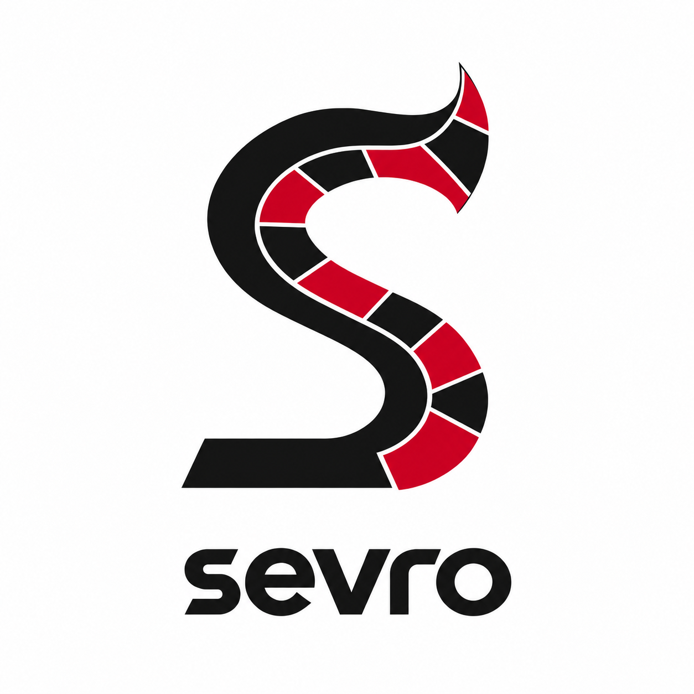

# Sevro

<p align="center">
  
</p>

Sevro evaluates coding agents against cases you define. It runs trials, grades
responses or project changes, and saves evidence so you can inspect the result.
Use it to compare agent configurations or check whether a skill works.

Sevro is source-available and works independently of [Darrow](https://github.com/BjRo/darrow).
Its [extension protocol](docs/extension-protocol-v1.md) lets projects supply their
own cases and grading policy.

## Try it

With Node.js 24.13.0 or newer and npm, run:

```sh
mkdir sevro-demo
cd sevro-demo
npm init -y
npm install --save-exact @bjoernrochel/sevro
npx sevro demo
```

The demo uses a deterministic adapter, so it needs no model account. It prints
`execution=completed grading=completed task=passed` and an `evidence=` path
under `.sevro/results`. It writes results in the current directory and uses a
separate temporary project. See [your first evaluation](docs/getting-started.md)
for a custom run and an explanation of the result.

Sevro also runs on Bun 1.3.13. Native isolation targets macOS and Ubuntu;
Windows is unverified. Native hosts have additional
[prerequisites](docs/native-hosts.md). See [installation](docs/installing.md)
for pinned versions, updates, and removal.

## Next steps

- [Create and run an evaluation](docs/evaluation-workflow.md).
- [Write cases and extensions](docs/creating-cases.md) or try a [recipe](docs/recipes.md).
- [Read results and evidence](docs/reading-results.md).
- [Use Sevro from Node or Bun](docs/embedding-api.md).
- Find troubleshooting, architecture, and reference material in the
  [documentation](docs/README.md).

## Ask the repository guide

Open the Sevro repository in a fresh Codex or Claude Code session and ask
“What is Sevro, and how do I run my first evaluation?” Explicit invocation is
`$sevro-guide` in Codex or `/sevro-guide` in Claude Code.
The guide reads sources, cites its answers, and handles follow-ups. It explains
commands; execution requires a separate request. See the
[guide contract and verification limits](docs/specs/repository-guide.md).
The npm package does not install the repository guide.

## Contribute

[CONTRIBUTING.md](CONTRIBUTING.md) covers setup, checks, fixtures, schema
regeneration, compatibility, and releases. [Documentation quality](docs/documentation-quality.md)
defines documentation checks and review.

Run `bun run check:typescript` for the complete quality gate and
`bun run check:typescript --fast` before committing. The
[TypeScript quality contract](docs/typescript-quality.md) defines the source
inventory, strict typing, property tests, coverage integrity, and supported
environment.

## License and acknowledgements

The [current release](docs/installing.md#current-release) uses the [Sevro Source Available License 1.0](LICENSE).
Use is free in every context, including commercial work and paid education.
Selling copies, rebranded versions, or hosted access to Sevro's functionality
requires a separate license. Modification and free redistribution remain allowed.
It is source-available, not an OSI open-source license. Read
[licensing](docs/licensing.md) for contribution grants and earlier BSL releases.

Björn Rochel created the logo. Sevro's name is inspired by the character in
Pierce Brown's _Red Rising_. Thank you, Pierce Brown, for the world and characters
that inspired both Sevro and Darrow. See [acknowledgements](docs/acknowledgements.md).
