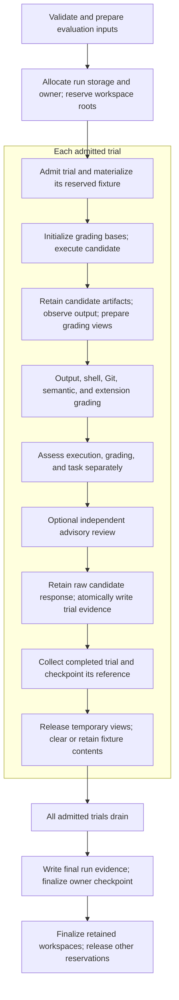

# How Sevro fits together

Sevro owns generic execution/evidence contracts. Projects own cases and policy.
This lets Darrow and other integrations use the same runner without importing
their benchmark policy into it.

This page explains this checkout's implementation and points to acceptance
tests for changes. [Current contracts](contracts.md) define public behavior;
[historical validation](https://github.com/BjRo/sevro/blob/main/docs/evidence.md) records bounded past observations. The
[engine slice](https://github.com/BjRo/sevro/blob/main/docs/engine-slice.md) retains its earlier scope and detailed lifecycle
explanation. Implementation paths and test scenarios here are navigation, not
evidence that a particular candidate passed validation.

[`engine.ts`](../src/engine.ts) remains the programmatic facade, and
[`cli.ts`](../src/cli.ts) builds to the installed `dist/src/cli.js` entrypoint.
The package runs on Node.js and Bun; contributor commands still use Bun.
[Process adapters](../src/runtime-process.ts) normalize child processes and
Web Streams. [SQLite locking](../src/sqlite-lock.ts) selects the runtime's native driver, preserving shared file-lock semantics. The CLI
loads and assembles evaluation options; evaluation modules coordinate the run
and its trials.

## Evaluation lifecycle

[`runEvaluation`](../src/evaluation/run.ts) prepares inputs before allocating
run resources, retains preparation artifacts, and reserves candidate and
semantic workspace roots as needed before calling the trial scheduler. The map
follows the path of a retained trial; individual stages can be skipped or fail.

[`scheduleTrials`](../src/evaluation/scheduler.ts) bounds active work by the
prepared job limit. It admits a trial before
[`prepareTrialWorkspace`](../src/evaluation/resources.ts) materializes that
trial's fixture. Each [`EvaluationTrial`](../src/evaluation/trial.ts) owns its
mutable state and writer. Its `run()` method keeps candidate execution,
artifact retention, grading, assessment, advisory review, persistence, and
cleanup in one visible order. Grading helpers return checks, observations,
and failures; the coordinator incorporates those results and stops new
admission when an execution or required grading error is detected, before
advisory work, persistence, or cleanup. The scheduler also stops admission on
cancellation and waits for active workers. A failed task check alone does not
close admission. Already admitted peers drain and retain their evidence, including
when they finish out of order.

[`runAdvisoryReview`](../src/evaluation/advisory.ts) handles its own host call,
assessment, retained response, and auxiliary workspace cleanup. It depends on
candidate completion, independently of the task assessment. The
[advisory fixture](advisory-fixture.md) gives review a separate Git view with
evaluator inputs withheld. Its recommendation or host failure does not change
task grading; a failure to retain its evidence remains a persistence error.

Successful [semantic response parsing](../src/evaluation/semantic.ts) clears
auxiliary fixture contents; successful advisory response parsing removes its
auxiliary fixture. Both retain response evidence first, including valid failed
check verdicts or advisory recommendations.

The [trial writer](../src/evidence/trial-writer.ts) writes the trial artifact
before the coordinator marks it persisted and hands it to the
[result collector](../src/evaluation/collection.ts). The collector registers
the completed record, orders records by trial number, and checkpoints retained
artifact paths. After active work drains, the run coordinator validates and
writes `run.json` before finalizing the owner as complete or interrupted.
Persistence failures cannot produce a successful result; the run's failure
path attempts a diagnostic checkpoint while preserving the original failure.

Trial cleanup releases candidate artifact runtimes and transcript views even
when the trial fails. Persisted successful fixture contents are cleared while
their empty reserved roots remain until active work drains. Failed, cancelled,
grading-error, unavailable-evidence, and failed-task fixtures are retained;
[workspace ownership](../src/fixtures/workspace-state.ts) tracks their inactive
retention and startup expiry after 24 hours. Saved evidence stays outside that
cleanup. See the [results retention contract](results-v1.md#identity-and-provenance)
for the public boundary, including ownership that cannot be verified.

Dry preparation still validates and materializes fixtures, including declared
fixture setup, and retains trial records. It skips candidate execution and
grading, recording `not_run` / `not_requested` / `not_assessed`, as exercised by
the [engine trial suite](../tests/src/engine-trials.test.ts). Missing observations
remain unavailable; missing required evidence cannot become a pass. Optional
unknown measurements remain unknown rather than becoming zero. Extensions
cannot silently replace isolation, persistence,
or built-in policy. The [results](results-v1.md) and
[extension protocol](extension-protocol-v1.md) contracts define those semantics.

## State ownership

[`EvaluationContext`](../src/evaluation/context.ts) carries four explicit
collaborators: prepared inputs, run resources, the result collector, and retained
preparation-artifact references. It does not combine mutable trial fields with
the preparation plan.

| Data or state                  | Owner                                                                                                                                                           | Boundary                                                                                                                                                                                                                                                                          |
| ------------------------------ | --------------------------------------------------------------------------------------------------------------------------------------------------------------- | --------------------------------------------------------------------------------------------------------------------------------------------------------------------------------------------------------------------------------------------------------------------------------- |
| Prepared inputs                | [`PreparedEvaluation` in `plan.ts`](../src/evaluation/plan.ts)                                                                                                  | Named fixture, check, and invocation groups plus routes, provenance, redacted configuration, and comparison identity. Preparation completes before run allocation.                                                                                                                |
| Run resources and reservations | [`RunResources` and `RunWorkspaceReservations` in `resources.ts`](../src/evaluation/resources.ts)                                                               | Run ID, evidence/state locations, process owner, and candidate/semantic reservations. Reservations outlive completed fixture contents; retained workspaces are tracked separately from completed roots.                                                                           |
| Mutable trial state            | [`TrialRuntimeState` and `EvaluationTrial` in `trial.ts`](../src/evaluation/trial.ts)                                                                           | Candidate result, observations, checks, assessment, temporary views, advisory result, and persisted milestone belong to one admitted trial. Grading receives narrow inputs and explicit effects rather than this state object.                                                    |
| Collected run results          | [`ResultCollector` in `collection.ts`](../src/evaluation/collection.ts)                                                                                         | Private completed summaries, evidence, and diagnostics; trial-number ordering, snapshots for aggregation, and checkpoint requests. [`run-owner.ts`](../src/run-owner.ts) verifies process ownership and writes owner/checkpoint state.                                            |
| Evidence writes                | [`TrialEvidenceWriter`](../src/evidence/trial-writer.ts), [preparation retention](../src/evaluation/resources.ts), [run finalization](../src/evaluation/run.ts) | The trial writer owns filenames, private writes, hashes, artifact references, and typed trial-persistence failures. Resource helpers retain preparation bytes; run finalization writes aggregate evidence. [`storage.ts`](../src/storage.ts) supplies atomic private JSON writes. |

Fixture modules own materialization and workspace preparation. Runtime modules
own declared host runtime policy and private state. Evidence modules validate
host observations and artifacts, verify retained bytes, and normalize optional
usage without constructing fixtures. Native host implementations and graders
remain in their own families.

## Where to change behavior

Start with the responsibility, then inspect its observable acceptance scenarios.
These are useful starting suites, not an exhaustive validation list. The
[contribution checks](../CONTRIBUTING.md#quality-contract-and-checks) still govern
candidate acceptance.

| Responsibility                                                    | Implementation and reference                                                                                                                                                                                                                                                             | Relevant acceptance tests                                                                                                                                                                                                         |
| ----------------------------------------------------------------- | ---------------------------------------------------------------------------------------------------------------------------------------------------------------------------------------------------------------------------------------------------------------------------------------- | --------------------------------------------------------------------------------------------------------------------------------------------------------------------------------------------------------------------------------- |
| Parse commands/select explicit routes                             | [CLI entrypoint](../src/cli.ts), [invocation parsing](../src/cli/invocation.ts), [CLI reference](development-cli.md)                                                                                                                                                                     | [Invalid invocations](../tests/src/cli/invocation-validation.test.ts)                                                                                                                                                             |
| Load and prepare a CLI evaluation                                 | [Input loading](../src/cli/loading.ts), [preparation](../src/cli/preparation.ts), [host construction](../src/cli/hosts.ts), [extension resolution](../src/cli/extension.ts), [evaluation assembly](../src/cli/evaluation.ts)                                                             | [Case/configuration validation](../tests/src/cli/case-validation.test.ts)                                                                                                                                                         |
| Present CLI results and own cancellation                          | [Presentation](../src/cli/presentation.ts), [cancellation](../src/cli/cancellation.ts), [command lifecycle](../src/cli/command.ts)                                                                                                                                                       | [CLI states and exits](../tests/src/cli/results.test.ts), [signal retention](../tests/src/cli/trial-retention.test.ts)                                                                                                            |
| Prepare evaluation inputs and grade trials                        | [Engine facade](../src/engine.ts), [plan](../src/evaluation/plan.ts), [grading](../src/evaluation/grading.ts), [semantic grading](../src/evaluation/semantic.ts), [evaluation modules](../src/evaluation/), [engine slice](https://github.com/BjRo/sevro/blob/main/docs/engine-slice.md) | [Preparation refusals](../tests/src/evaluation/preparation-validation.test.ts), [semantic grading failures](../tests/src/evaluation/semantic-grading-failures.test.ts), [engine lifecycle](../tests/src/engine-lifecycle.test.ts) |
| Schedule trials, retain evidence, and finalize ownership          | [Scheduler](../src/evaluation/scheduler.ts), [trial coordinator](../src/evaluation/trial.ts), [reservations](../src/evaluation/resources.ts), [collection](../src/evaluation/collection.ts), [run owner](../src/run-owner.ts)                                                            | [Concurrent admission and ordering](../tests/src/cli/concurrency.test.ts), [trial failures and retention](../tests/src/evaluation/trial-retention.test.ts), [checkpoint refusals](../tests/src/run-owner-checkpoints.test.ts)     |
| Prepare, construct, and clean up fixtures                         | [Fixture modules](../src/fixtures/), [construction](../src/fixtures/create.ts), [preparation artifacts](../src/fixtures/preparation.ts), [content cleanup](../src/fixtures/cleanup.ts), [workspace ownership](../src/fixtures/workspace-state.ts)                                        | [Artifact preparation](../tests/src/fixtures/artifact-preparation.test.ts), [workspace lifecycle](../tests/src/fixtures/workspace-lifecycle.test.ts)                                                                              |
| Resolve runtime policy, discovery, and private state              | [Runtime modules](../src/runtime/), [configuration](../src/runtime/config.ts)                                                                                                                                                                                                            | [Runtime environment](../tests/src/runtime/environment.test.ts), [candidate artifact lifetime](../tests/src/candidate-artifacts.test.ts)                                                                                          |
| Validate host results and retain bounded evidence                 | [Host results](../src/evidence/host-results.ts), [trial writer](../src/evidence/trial-writer.ts), [retained artifacts](../src/evidence/retained-artifacts.ts), [usage](../src/evidence/usage.ts)                                                                                         | [Host evidence refusals](../tests/src/evaluation/host-evidence.test.ts), [failed-host evidence retention](../tests/src/evaluation/trial-retention.test.ts)                                                                        |
| Negotiate trusted extension calls                                 | [Client](../src/extension-client.ts), [session](../src/extension-session.ts), [extension grading](../src/evaluation/grading.ts), [protocol](extension-protocol-v1.md)                                                                                                                    | [Negotiated engine behavior](../tests/src/evaluation/extension-engine.test.ts), [extension grading outcomes](../tests/src/evaluation/extension-grading.test.ts)                                                                   |
| Run independent advisory review                                   | [Advisory execution](../src/evaluation/advisory.ts), [blind fixture](../src/fixtures/advisory.ts), [advisory fixture explanation](advisory-fixture.md)                                                                                                                                   | [Advisory failures](../tests/src/evaluation/advisory-failures.test.ts), [blind change view](../tests/src/fixtures/advisory.test.ts)                                                                                               |
| Run native hosts and retain bounded observations                  | [Codex](codex-host.md), [native controls](native-controls.md), [host sources](../src/hosts/), [shared process mechanics](../src/process-lifecycle.ts), [native waiting](../src/hosts/process-lifecycle.ts)                                                                               | [Native process admission and byte bounds](../tests/src/hosts/native-process-boundaries.test.ts)                                                                                                                                  |
| Reduce execution/grading/task states and maintain contract shapes | [Result reduction](../src/results.ts), [shared semantic types](../src/contract-types.ts), [wire types](../src/schema-types.ts), [runtime schema boundary](../src/schema.ts), [results contract](results-v1.md)                                                                           | [State and exit precedence](../tests/src/results.test.ts), [evidence schema boundaries](../tests/src/schema/evidence-boundaries.test.ts)                                                                                          |
| Bind comparison identities and release provenance                 | [Preparation identity inputs](../src/evaluation/plan.ts), [identity hashing](../src/identity.ts), [provenance](../src/provenance.ts), [identity contract](identity-v1.md), [releases](releases.md)                                                                                       | [CLI identity](../tests/src/cli/identity.test.ts), [package release provenance](../tests/scripts/release.test.ts)                                                                                                                 |
| Summarize retained results                                        | [Report implementation](../src/report.ts), [report contract](report-v1.md)                                                                                                                                                                                                               | [Report states and CLI](../tests/src/report.test.ts)                                                                                                                                                                              |

[Rust research](https://github.com/BjRo/sevro/issues/2) does not establish a
migration; public interfaces remain useful independently. Return to the
[documentation hub](README.md).
